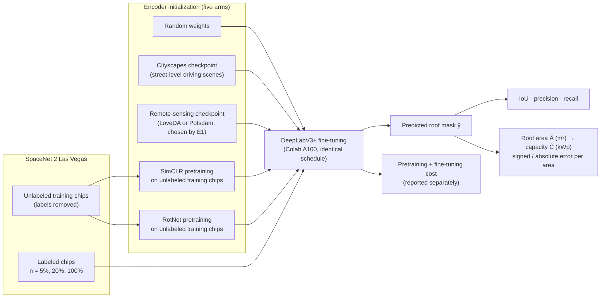

# Transfer or Self-Supervise? Label-Efficient Rooftop Segmentation for Solar Capacity Estimation

**ECE 661 Course Project — Project D Methods on Overhead Imagery**  
**Team 26 · Bruce Chen · Yachen He · Duke University**

---

## Overview

Estimating how much solar power a city could install on its rooftops starts with knowing
how much roof area it has. A segmentation network can outline roofs in satellite imagery,
but only if it has been trained on examples that people have traced by hand — and such
labels exist for only a few cities. Meanwhile, two potential remedies sit nearby:

- **Pretrained checkpoints** are freely available, but they were trained on other kinds of
pictures: street scenes photographed from a car (Cityscapes), satellite land cover
(LoveDA), or aerial imagery at a very different resolution (ISPRS Potsdam).
- **Unlabeled imagery of the target city itself** is plentiful, and self-supervised methods
such as SimCLR and RotNet can learn features from it without any traced examples.

This project asks, in one controlled comparison:

> **Which source of pretrained features helps most when roof masks are scarce, at what
> compute cost, and does the difference actually change the solar-capacity estimate a
> planner would read?**

We apply the transfer-learning methodology of Project D to rooftop segmentation on the
SpaceNet 2 Las Vegas building-footprint dataset, then extend it with a controlled
comparison of **five encoder initializations × three label budgets** on a single fixed
architecture. Finally, we carry segmentation errors through to roof area (m²) and an
area-based solar capacity estimate (kWp), instead of reporting pixel metrics alone.

A note on scope: SpaceNet labels are **building footprints**, not visible or usable roof
area. Throughout this project, all area and capacity figures are therefore called
**roof-area proxies**, and no claim is made about structural suitability for solar
installation or about electricity generation.

Because this adapts the listed Project D task and dataset, TA approval for the adapted
scope will be sought before Week 2.

---

## Approach at a Glance

Every experimental arm shares one architecture (DeepLabV3+ with a ResNet-50 encoder),
one labeled dataset, one fine-tuning procedure, and one evaluation protocol. Only the
encoder initialization $\theta_0$ and the label budget $n$ vary, so observed differences
can be attributed to those two factors.



### The five initializations

| Arm | $\theta_0$ | Source | Route |
|---|---|---|---|
| 1 | $\theta_{\text{rand}}$ | Standard random initialization | Purely supervised reference point |
| 2 | $\theta_{\text{city}}$ | Encoder of the MMSegmentation Cityscapes DeepLabV3+ R-50 checkpoint | Out-of-domain transfer (Project D route) |
| 3 | $\theta_{\text{RS}}$ | Encoder of whichever of the LoveDA / Potsdam checkpoints performs better zero-shot on validation blocks | Near-domain transfer |
| 4 | $\theta_{\text{SimCLR}}(D_U)$ | SimCLR pretraining on unlabeled Las Vegas training chips | In-domain self-supervision |
| 5 | $\theta_{\text{Rot}}(D_U)$ | RotNet pretraining on unlabeled Las Vegas training chips | In-domain self-supervision |

Label budgets: $n \in 5,\ 20,\ 100$ of the labeled training chips, with the
**same chips given to every arm** at a given budget.

---

## Objectives

| ID | Objective |
|---|---|
| **O1** | **Data pipeline (Project D basic).** Download SpaceNet 2 Las Vegas, rasterize footprint polygons into masks in MMSegmentation format, split by geographic area, visualize samples, document core statistics (chip count, resolution, roof-pixel fraction), and verify the pixel-to-m² conversion. |
| **O2** | **Transfer-learning baseline (Project D basic).** Evaluate at least two pretrained MMSegmentation models with no fine-tuning, then fine-tune the most suitable one, targeting IoU, precision, and recall. |
| **O3** | **Controlled initialization comparison (extension).** Compare the five encoder initializations at three label budgets on one fixed architecture — adapting the self-supervised comparison of Project 4 from classification to segmentation. |
| **O4** | **Area, capacity, and cost.** Convert predicted masks into roof area (m²) and estimated potential capacity (kWp), measure how segmentation errors propagate into both, and report pretraining and fine-tuning compute separately. |
| **O5** | **Reproducible deliverables.** Code, configuration files, training logs, a README with exact commands, figures, the poster, and the final report. |

---

## Dataset

### SpaceNet 2 — Las Vegas

| Property | Value |
|---|---|
| Source | [SpaceNet 2](https://registry.opendata.aws/spacenet/) (Van Etten et al., 2018), WorldView-3 imagery |
| License | CC BY-SA 4.0; downloadable anonymously from the AWS Open Data bucket, no paid data |
| Coverage | Las Vegas area of interest: 216 km², ≈151,000 labeled buildings |
| Imagery | Pan-sharpened RGB, 0.3 m ground sample distance |
| Chips | 650 × 650 px (200 × 200 m on the ground) |
| Labels | Building-footprint polygons, rasterized to binary masks (2 classes: background, roof proxy) |
| Preprocessing | 16-bit → 8-bit with one fixed percentile stretch computed on the training partition only; masks rasterized with publicly available SpaceNet utilities |
| Archive size | ≈24 GB (Las Vegas) — downloaded once; only pan-sharpened RGB and labels retained |

### Geographic split (leakage control)

Random chip-level splits leak information between adjacent chips, so the split happens
**before** any chips are extracted:

1. Divide Las Vegas into contiguous geographic blocks of ≈1 km².
2. Assign whole blocks to train / validation / test partitions (≈70 / 15 / 15).
3. Drop a one-chip buffer between partitions so adjacent chips never fall on opposite

   sides of a split.
4. Self-supervised pretraining uses **training-partition images only**.
5. Each test block doubles as one evaluation area for the area and capacity estimates.

The split is stored in a versioned file and checked by script (no chip may appear in
more than one partition).

### Data verification (before any training)

- Visual overlays inspected on at least 20 random chips.
- Rasterized mask area compared against polygon area computed directly from the vector
footprints — target agreement within 2% on sample chips.
- Pixel-to-m² conversion checked by reading each chip's georeferencing, reprojecting to
the local UTM zone if chips are stored in geographic coordinates.

### North Carolina extension (pilot dataset built)

In addition to the proposal's Las Vegas target, a pilot **North Carolina** dataset has
been built with the same chip/mask protocol, because NC publishes excellent free
statewide data — and a held-out NC city is a realistic "few labels in a new place" test:

| Component | Source | What was obtained |
|---|---|---|
| Imagery | [NC OneMap Orthoimagery](https://www.nconemap.gov/pages/imagery) (`Orthoimagery_Latest` image service, exported at 0.30 m to match SpaceNet) | 5 tiles of 4000×4000 px (1.2 km) — Raleigh ×2, Durham, Charlotte ×2 (~230 MB) |
| Labels | [NC statewide building footprints](https://sdd.nc.gov/buildingfootprints) (NCEM File Geodatabases, layer `S_BUILDING_FP`) | Wake (2021), Durham (2021), Mecklenburg (2023) county files (~200 MB zips) |
| Processed pilot | `data/processed/nc/` | **180 chips** (650×650): Raleigh = train (72), Durham = val (36), Charlotte = **held-out test city** (72); mean roof-pixel fraction 0.226 |

Two practical findings from building it: (1) the single-cycle service
`Orthoimagery_20242027` covers only the eastern flight block — Charlotte exports from
it are blank, so `Orthoimagery_Latest` must be used for western NC; (2) footprint
vintages (2021–2023) can predate the imagery, so overlay QA is mandatory before
trusting a chip. NC footprints also carry useful attributes (roof shape/slope, year
built) for later usable-area sensitivity analysis.

### Data status — obtained, deferred, and blocked

All datasets below are free and need **no account or credentials**; prioritization is
by "needed to run the next experiment" and by local disk (this laptop has ~37 GB free,
so the full 25.6 GB Vegas tarball + extraction does not fit locally — it belongs on
Colab/Drive, exactly as the proposal's compute plan already assumes).

| Priority | Dataset | Status |
|---|---|---|
| P0 | SpaceNet 2 Vegas, 120-chip subset (PS-RGB + GeoJSON, ~294 MB) → `data/processed/spacenet_vegas/` (91/20/9 block split, area check median ratio 0.992) | ✅ Downloaded + processed + verified locally |
| P0 | NC pilot (above) → `data/processed/nc/` (180 chips) | ✅ Downloaded + processed + verified locally |
| P0 | **Full** SpaceNet 2 Vegas (25.6 GB tarball) for the complete E2/E3 grid | ⏳ Run `download_spacenet.py --full-tarball` on Colab (needs ≥60 GB scratch) — **external compute required** |
| P1 | MMSegmentation DeepLabV3+ R-50 checkpoints (Cityscapes / LoveDA / Potsdam) for E1 | ⏳ Download in the Colab environment where MMCV/MMSegmentation is installed; not useful on this laptop |
| P1 | Project Sunroof city/ZIP aggregates (capacity validation) + NREL NSRDB (NC irradiance) | ⏳ Small CSV downloads when E5 starts; no registration |
| P2 | INRIA Aerial Labeling, xBD (incl. Hurricane Florence NC coast), NC LiDAR DEMs (3-ft county mosaics are multi-GB each) | ⏳ Optional stretch/cross-region sources; download only if an experiment needs them |
| — | Anything requiring payment, a license key, or manual approval | ❌ None needed for the core project. **TA approval for the adapted (and NC-extended) scope is still required** (see Overview) |

Reproduce the local data at any time with the commands in
[Getting Started](#getting-started); every script skips files that already exist.

---

## Method

### Architecture

- **Model:** DeepLabV3+ with a ResNet-50 encoder (`R-50-D8`, output stride 8), from
[MMSegmentation](https://github.com/open-mmlab/mmsegmentation).
- In every controlled-comparison arm the decoder is newly initialized; only the encoder
starting weights differ. Both self-supervised methods pretrain exactly the ResNet-50
definition used by the segmentation encoder, so weights load without modification.

### E1 — Project D baseline (zero-shot, then fine-tune)

Three DeepLabV3+ R-50 checkpoints from the MMSegmentation model zoo share an
architecture but were trained on different domains:

| Checkpoint | Training domain | Resolution / viewpoint |
|---|---|---|
| Cityscapes | Street-level driving scenes | Ground-level |
| LoveDA | Satellite land cover | 0.3 m, overhead |
| ISPRS Potsdam | Aerial imagery | ≈5 cm, overhead |

All three label spaces contain a "building" class, so each can be evaluated with **no
fine-tuning** by mapping that class to the roof mask. For Potsdam, we additionally test
rescaling the input to reduce the resolution mismatch. The most promising checkpoint is
then fine-tuned on all training chips (decoder kept, only the final classification layer
replaced), and these runs fix the fine-tuning settings used everywhere else.

### Self-supervised pretraining (TPU)

**SimCLR.** Two augmented views $\tilde{x}_i, \tilde{x}_j$ of the same unlabeled chip are
encoded and projected to $z = h(f_\theta(\tilde{x}))$. With $2N$ views per batch and
cosine similarity $\mathrm{sim}$, the NT-Xent loss for a positive pair is

$$
\ell_{i,j} = -\log \frac{\exp(\mathrm{sim}(z_i, z_j)/\tau)}
{\sum_{k \ne i} \exp(\mathrm{sim}(z_i, z_k)/\tau)},
$$

averaged over all positive pairs. The projection head $h$ is discarded after pretraining.

**RotNet.** Each unlabeled chip is rotated by $r \in 0°, 90°, 180°, 270°$ and a linear
head $p_\psi$ predicts the rotation:

$$
L_{\text{rot}}(\theta, \psi) = -\frac{1}{|G|} \sum_{r \in G}
\log p_\psi\big(r \mid f_\theta(\mathrm{Rot}(x, r))\big).
$$

### Fine-tuning at controlled label budgets

For each $(\theta_0, n)$, the full network is trained on the labeled subset
$D_L^{(n)}$ with pixel-wise cross-entropy,

$$
L_{\text{seg}} = -\frac{1}{|\Omega|} \sum_{q \in \Omega} \log s(x)_{q, y_q},
$$

where $\Omega$ is the set of pixels in a crop. All arms at a given budget receive the
same chips, schedule, augmentation, and validation-based model selection.

**Frozen-encoder probes (E4).** For each pretrained arm we also train with the encoder
frozen and only the decoder learning. This segmentation-oriented probe plays the role
that linear evaluation plays for classification in Project 4, and diagnoses whether a
pretraining method learned useful features even when full fine-tuning looks similar.

### Planned settings

Subject to tuning during Weeks 1–2; final values will be documented here.

| Setting            | Value                                                                                                                                                     |
| ------------------ | --------------------------------------------------------------------------------------------------------------------------------------------------------- |
| Classes            | 2 (background, roof / footprint proxy)                                                                                                                    |
| Label budgets      | $n \in 5, 20, 100$; identical subsets across arms; 3 random subsets (seeds) at 5% and 20% (E3)                                                            |
| Unlabeled pool     | All training-partition chips with labels removed                                                                                                          |
| SimCLR             | 224×224 crops, batch 128 pairs, $\tau = 0.2$, 2-layer projection head (128-d), SGD + cosine schedule, 200 epochs, bf16                                    |
| RotNet             | Rotations $0°, 90°, 180°, 270°$, linear rotation head, batch 256, 100 epochs                                                                              |
| Augmentations      | Random resized crop, flips, 90° rotations (excluded from the RotNet pretext task), color jitter, Gaussian blur                                            |
| Fine-tuning        | SGD (lr 0.01, momentum 0.9, weight decay 5×10⁻⁴), poly decay, 4k iterations, batch 8, 512×512 crops, scale 0.75–1.25, mixed precision, cross-entropy loss |
| Probe              | Encoder frozen; decoder trained with the fine-tuning schedule                                                                                             |
| Capacity constants | Usable fraction $u = 0.70$, power density $\rho = 0.16$ kWp/m² (after Gagnon et al., 2016), fixed for all models                                          |
| Hardware           | Colab A100 for all MMSegmentation runs; one Cloud TPU v5e chip with PyTorch/XLA for self-supervised pretraining                                           |

### From segmentation to area and capacity

For evaluation area $k$ with pixel set $P_k$, where pixel $q$ covers $a_q$ m² on the
ground, the predicted roof-proxy area and estimated potential capacity are

$$
\hat{A}_k = \sum_{q \in P_k} a_q \, \mathbb{1}[\hat{y}_q = 1],
\qquad
\hat{C}_k = u \, \rho \, \hat{A}_k .
$$

Applying the same formulas to the reference masks gives $A_k$ and $C_k$. We report the
signed error $e_k = \hat{A}_k - A_k$ (m²), the relative error
$r_k = (\hat{A}_k - A_k)/A_k = (\hat{C}_k - C_k)/C_k$ (%), and the capacity error in kWp,
per evaluation area and in aggregate.

Because $\hat{C}_k$ is linear in $\hat{A}_k$, the relative capacity error equals the
relative area error: changing $u$ or $\rho$ rescales every model's capacity error
equally and is never treated as evidence that one model is better than another.

---

## Experiments

| ID     | Experiment                                                                                                                                   | Runs                        |
| ------ | -------------------------------------------------------------------------------------------------------------------------------------------- | --------------------------- |
| **E1** | Project D baseline: Cityscapes, LoveDA, and Potsdam checkpoints evaluated zero-shot; full fine-tuning of the most promising one at $n = 100$ | 3 evaluations + 1 fine-tune |
| **E2** | Initialization × budget: the five arms at $n \in 5, 20, 100$                                                                                 | 15 runs                     |
| **E3** | Repeated subsets: the five arms at $n \in 5, 20$ with two additional random labeled subsets                                                  | 20 runs                     |
| **E4** | Frozen-encoder probes for the four pretrained arms at each budget                                                                            | 12 runs                     |
| **E5** | Area and capacity error ($e_k$, $r_k$, kWp) for all E2 models                                                                                | Analysis of E2              |
| **E6** | Cost: compute and wall-clock time for every pretraining and fine-tuning run                                                                  | Logging                     |

**Stretch goals (only if ahead of schedule):** cross-region evaluation on another
SpaceNet 2 city with no tuning on its labels; cross-entropy + Dice loss to sharpen roof
boundaries; continued SimCLR pretraining starting from the remote-sensing weights.

### Evaluation protocol

- **Segmentation quality:** roof IoU, precision, and recall on geographically held-out
test blocks.
- **Area and capacity error:** signed and absolute $e_k$ (m²), $r_k$ (%), and capacity
error (kWp), per evaluation area and in aggregate.
- **Representation quality:** probe IoU per pretrained arm; RotNet pretext accuracy.
- **Uncertainty:** 95% bootstrap intervals over test chips; spread across the repeated
labeled subsets (E3).
- **Cost:** pretraining and fine-tuning hours reported separately by hardware, plus
inference time per km².

### Hypotheses

| ID     | Hypothesis                                                                                                                                                                                                                                     |
| ------ | ---------------------------------------------------------------------------------------------------------------------------------------------------------------------------------------------------------------------------------------------- |
| **H1** | Zero-shot (E1), the LoveDA checkpoint — matched to our 0.3 m resolution and overhead view — segments roofs far better than street-level Cityscapes; the 5 cm Potsdam checkpoint improves when the input is rescaled.                           |
| **H2** | Every pretrained initialization beats random initialization at $n = 5$, and the gap narrows at $n = 100$.                                                                                                                                      |
| **H3** | Remote-sensing transfer is the strongest initialization at small budgets; SimCLR on unlabeled Las Vegas chips closes part of the gap between Cityscapes transfer and remote-sensing transfer.                                                  |
| **H4** | RotNet is the weaker self-supervised method: overhead images have no natural "up," so rotation can be predicted mainly from cues such as shadow direction, which say little about roof outlines. Its probe (E4) should show this most clearly. |
| **H5** | Area errors come mainly from roof boundaries and shadows. At $n = 100$, signed errors largely cancel in aggregate while per-area absolute errors remain noticeably larger; at $n = 5$, area is systematically under- or over-estimated.        |

A well-supported finding that *no* pretraining helps would also answer the research
question, and negative results will be reported as findings.

---

## Success Criteria

### Midterm (end of Week 3)

- [ ] **Data pipeline:** all Las Vegas chips converted; overlays checked on ≥20 random
  ```
  chips; no chip shared across partitions; rasterized area within 2% of polygon area
  on sample chips.
  ```
- [ ] **Project D baseline (E1):** three checkpoints evaluated zero-shot; the selected
  ```
  model fine-tuned at $n = 100\%$ reaches roof **IoU ≥ 0.70** on validation blocks.
  ```
- [ ] **Pretrained encoders:** SimCLR and RotNet losses converge; RotNet pretext accuracy
  ```
  reported; both load into DeepLabV3+ with no missing or unexpected encoder keys.
  ```
- [ ] **Area and capacity module:** exact on synthetic masks; reference area and capacity
  ```
  computed for every evaluation area.
  ```

### Final (end of Week 5)

- [ ] **Core comparison (E2, E3):** all 15 (arm, budget) results on the test blocks with
  ```
  95% bootstrap intervals; three subsets at $n \in \{5\%, 20\%\}$.
  ```
- [ ] **Label efficiency:** IoU-vs.-budget curve per arm; the smallest budget at which
  ```
  each pretrained arm matches random initialization at $n = 100\%$ within the
  intervals — or a clear statement that none does.
  ```
- [ ] **Area and capacity error (E5):** signed and absolute area error (m², %) and
  ```
  capacity error (kWp) for every model, per evaluation area and in aggregate.
  ```
- [ ] **Cost (E6):** TPU chip-hours and A100-hours logged per run; spending within the
  ```
  TPU share and the Colab plan.
  ```
- [ ] **Deliverables:** code, configurations, logs, README with exact commands, figures,
  ```
  poster, and final report.
  ```

---

## Repository Layout

```
Roof-Solar-Segmentation/
├── README.md                        # this file
├── ECE661_Final_Project_Proposal.pdf
├── requirements.txt                 # data-pipeline dependencies (rasterio, shapely, pyogrio, ...)
├── configs/
│   └── nc_aois.json                 # NC pilot areas of interest (Raleigh/Durham/Charlotte)
├── scripts/
│   ├── common.py                    # percentile stretch, geographic block split, overlays
│   ├── download_spacenet.py         # ✅ SpaceNet 2 chips (subset) or full tarball, from public S3
│   ├── download_nc.py               # ✅ NC footprints (.gdb zips) + NC OneMap imagery exports
│   ├── prepare_spacenet.py          # ✅ rasterize GeoJSON, UTM area check, ~1 km block split
│   ├── prepare_nc.py                # ✅ reproject to UTM 17N, rasterize footprints, split by city
│   ├── check_data.py                # ✅ midterm data criteria: no split leakage, binary masks,
│   │                                #    raster-vs-polygon area within 2%, overlay QA
│   ├── area_capacity.py             # ✅ mask → area (m²) → capacity (kWp); --self-test + E5 CLI
│   ├── pretrain_simclr.py           # planned (TPU / PyTorch-XLA)
│   ├── pretrain_rotnet.py           # planned (TPU / PyTorch-XLA)
│   ├── extract_encoder.py           # planned (pull ResNet-50 weights from MMSeg checkpoints)
│   ├── train.py                     # planned (fine-tuning / probes, wraps MMSegmentation)
│   └── evaluate.py                  # planned (IoU, precision, recall, bootstrap intervals)
├── data/                            # not tracked in git (downloaded; see Data status)
│   ├── raw/{spacenet,nc}/           # source chips, GeoJSONs, imagery tiles, footprint GDBs
│   └── processed/{spacenet_vegas,nc}/  # images/, masks/, split.csv, stats.json, overlays/
├── logs/                            # training logs and loss curves for every run
├── results/                         # comparison tables, IoU-vs-budget curves, example masks
└── report/                          # poster and final report
```

Data, checkpoints, and large logs are kept out of version control (Google Drive /
Colab); only code, configs, split files, and result summaries are tracked.

---

## Getting Started

> Steps 1–2 and 6 below are implemented and verified; steps 3–5 are the planned
> training workflow and will be updated with exact commands as those scripts land
> (Objective O5). Local setup used Python 3.12 (miniforge) with
> `pip install -r requirements.txt`.

### Environment

- **Segmentation (Colab A100):** PyTorch + MMSegmentation. MMCV (< 2.2.0) requires
matched PyTorch/CUDA builds, so a working combination is pinned in Week 1 and the
setup script is saved in this repo. All debugging happens on CPU or a free Colab T4
before any paid run. If the MMSegmentation stack proves unstable on Colab, the
fallback (after consulting the TA) is the same DeepLabV3+ implemented in plain PyTorch
with converted checkpoint weights.
- **Self-supervised pretraining (Cloud TPU v5e):** plain PyTorch with PyTorch/XLA,
started via the course `ece661` tool. Static shapes (fixed crop size, `drop_last`) and
host-CPU augmentation avoid XLA recompilation stalls; fallback is shorter pretraining
on Colab A100.

### Workflow

```bash
pip install -r requirements.txt

# 1a. SpaceNet 2 Las Vegas -- development subset (120 chips, ~300 MB, no AWS account)
python scripts/download_spacenet.py --city AOI_2_Vegas --num-chips 120
#     Full city for the E2/E3 grid (25.6 GB -- run on Colab, not a laptop):
# python scripts/download_spacenet.py --city AOI_2_Vegas --full-tarball

# 1b. North Carolina -- county footprints + NC OneMap imagery for the pilot AOIs
python scripts/download_nc.py            # AOIs in configs/nc_aois.json

# 2. Build chips/masks + geographic splits, then verify (proposal midterm criteria)
python scripts/prepare_spacenet.py
python scripts/prepare_nc.py
python scripts/check_data.py --dataset data/processed/spacenet_vegas
python scripts/check_data.py --dataset data/processed/nc
#     -> inspect data/processed/*/overlays/*.png (>=20 chips) before any training

# 3. Zero-shot baseline (E1): evaluate Cityscapes / LoveDA / Potsdam checkpoints,
#    then fine-tune the selected checkpoint at n = 100%        [planned, Colab]

# 4. Self-supervised pretraining on unlabeled training chips (TPU)  [planned]
# python scripts/pretrain_simclr.py    # 200 epochs, ResNet-50 encoder
# python scripts/pretrain_rotnet.py    # 100 epochs, ResNet-50 encoder

# 5. Controlled comparison (E2/E3), probes (E4): five arms x three budgets [planned]

# 6. Area / capacity analysis (E5) and cost summary (E6)
python scripts/area_capacity.py --self-test
python scripts/area_capacity.py --pred-dir <predicted masks> \
    --mask-dir data/processed/nc/masks/test --pixel-area-m2 0.09
```

Checkpoints are saved every 500 iterations (to Google Drive) so Colab disconnects lose
at most a fraction of a run.

---

## Compute Budget

No paid data or software: SpaceNet 2 is public (CC BY-SA 4.0) and all code is
open-source PyTorch / PyTorch-XLA / MMSegmentation. The only monetary cost is compute.
The course provides $250 of Google Cloud credit per group, of which $100 is allocated to
the Gemini API (coding assistance) and **$150 to TPU compute**; Colab A100 time is paid
separately with Colab compute units, outside the course credit.

| Item | Platform | Hours | Est. cost (USD) |
|---|---|---:|---:|
| TPU smoke tests + throughput measurement | TPU v5e | 2 | $2.40 |
| SimCLR pretraining (ResNet-50, 200 epochs) | TPU v5e | 6 | $7.20 |
| RotNet pretraining (100 epochs) | TPU v5e | 4 | $4.80 |
| Stretch: SimCLR from remote-sensing weights | TPU v5e | 5 | $6.00 |
| **TPU subtotal** | | **17** | **$20.40** |
| TPU contingency (100%: reruns, failures, idle) | | 17 | $20.40 |
| **TPU total planned** (reserve: $109.20 unallocated) | | **34** | **≈$40.80** |
| Colab: setup, E1–E6, stretch (incl. 100% contingency) | Colab A100 (40 GB) | 68 | ≈$36.72 |

TPU priced at the on-demand v5e rate of $1.20/chip-hour; Colab A100 at ≈$0.54/hour.
Per-run fine-tuning estimates (~0.5 A100-hour per 4k-iteration run) are conservative and
will be revised after Week-1 throughput measurements.

**Spending rules.** (1) End TPU/Colab sessions as soon as a job finishes — a v5e chip
left running over a 60-hour weekend would cost $72, nearly half the TPU share.
(2) Debug on CPU or free T4 first. (3) Weekly spend check; if TPU spending exceeds $75
or Colab exceeds $25 by the midterm check-in, stretch goals are dropped. Pretraining and
fine-tuning hours are always logged and reported separately (E6).

---

## Timeline (5 weeks, from the week of October 26)

| Week | Milestones |
|---|---|
| **1** | Pin the Colab MMSegmentation environment and metric code (IoU, precision, recall, bootstrap intervals); download SpaceNet, rasterize masks, build the geographic block split and dataset statistics; verify pixel-to-m² against polygons; TPU smoke test and throughput measurement. |
| **2** | Zero-shot evaluation of the three checkpoints (E1); fine-tune the selected model; area and capacity module; start SimCLR and RotNet pretraining (so one rerun still fits). |
| **3** | Finish pretraining and frozen-encoder probes (E4); **midterm check-in with the TAs** (targets above). |
| **4** | Controlled comparison: all five arms across budgets (E2), repeated labeled subsets (E3). All core experiments finish this week (Thanksgiving falls in Week 5). |
| **5** | Area, capacity, and cost analysis (E5, E6); stretch goals or buffer; documentation and README; poster and final report; poster session. |

### Division of labor (~50 / 50)

| Stage | Bruce Chen | Yachen He |
|---|---|---|
| Foundations | Pinned Colab MMSegmentation environment; metric code | SpaceNet download, mask rasterization, percentile stretch, block split, statistics; TPU setup |
| Project D baseline | Zero-shot evaluation of the three checkpoints; model selection; full fine-tuning (E1) | Sample visualizations and dataset documentation; pixel-to-m² verification |
| Pretraining & probes | Encoder extraction from Cityscapes / remote-sensing checkpoints; weight-loading checks for all arms | SimCLR and RotNet pretraining on TPU; frozen-encoder probes (E4) |
| Controlled comparison | Random, Cityscapes, remote-sensing arms (E2); half of E3 | SimCLR and RotNet arms (E2); half of E3 |
| Analysis | Area and capacity module; per-area error analysis (E5); failure cases | Label-efficiency curves; probe analysis; compute and credit tracking (E6) |
| Writing | Report: baseline, area/capacity sections; half of poster | Report: data and pretraining sections; half of poster |

Both members review each other's code, take part in all experiments, and share report
and poster writing. Total human effort ≈10–12 hours per member per week (~110
person-hours).

---

## Risks and Mitigations

| Risk | Likelihood | Mitigation |
|---|---|---|
| MMSegmentation environment breaks on Colab (MMCV/PyTorch/CUDA mismatch) | Medium | Pin a working combination in Week 1 and save the setup script; fallback to plain-PyTorch DeepLabV3+ with converted weights, after consulting the TA |
| PyTorch/XLA problems on TPU (recompilation, slow input pipeline) | Medium | Static shapes, host-CPU augmentation, Week-1 smoke test; fallback to shorter pretraining on Colab A100 |
| Building footprints ≠ visible or usable roof area | High | Call all measurements roof-area **proxies**; inspect overlays for misalignment; analyze failure cases; no claims about usable roof area |
| Geographic leakage between partitions | Medium | ≈1 km² block split with a one-chip buffer, applied before cropping; versioned split file checked by script; pretraining on training partition only |
| Wrong pixel-to-m² conversion | Low | Reproject to UTM; compare rasterized mask areas with polygon areas before any training |
| Large download (≈24 GB), 16-bit imagery | Medium | Download once, retain only pan-sharpened RGB + labels; one fixed percentile stretch for all arms |
| Pretraining does not help; RotNet exploits shadow direction | Medium | Probes (E4) diagnose representation quality; negative results reported as findings |
| Colab disconnects / no A100 available | Medium | Checkpoint every 500 iterations to Drive; runs are short; fall back to L4 GPU |
| Overspending | Low | Debug on CPU/free T4; end sessions promptly; weekly spend checks and midterm spending caps (above) |
| Two-person team capacity | Medium | Scope limited to Project D basics + one extension; stretch goals explicitly optional; balanced ownership |

---

## Who Cares?

- **Planners and researchers estimating rooftop solar potential.** Many regions lack
LiDAR and labeled footprints. Knowing whether limited effort is better spent reusing
existing checkpoints, self-supervised pretraining on local imagery, or labeling more
chips is directly actionable.
- **Anyone consuming the estimate.** Reporting errors in m² and kWp per area shows
whether an IoU gain changes the number a planner would read, and whether errors cancel
in aggregate or bias it.
- **Course practice.** Project D targets adapting an existing toolbox and its pretrained
models to a new domain; a documented, reproducible MMSegmentation pipeline for
SpaceNet, plus a clear account of what transfers and what does not, serves that goal.

---

## Deliverables

1. Clean code repository: data conversion, pretraining, fine-tuning, and evaluation

   scripts.
2. Training logs and loss curves for every run.
3. Comparison tables and IoU-vs.-budget curves for E1–E6, with example predicted masks

   and failure cases (shadows, tree cover, ambiguous roof boundaries).
4. This README, documenting all settings and the exact commands for every run.
5. Poster and final report, including a statement of each member's contributions.

---

## References

1. Gagnon, P., Margolis, R., Melius, J., Phillips, C., & Elmore, R. *Rooftop Solar

   Photovoltaic Technical Potential in the United States: A Detailed Assessment.*
    NREL/TP-6A20-65298, National Renewable Energy Laboratory, 2016.
2. Yu, J., Wang, Z., Majumdar, A., & Rajagopal, R. DeepSolar: A Machine Learning

   Framework to Efficiently Construct a Solar Deployment Database in the United States.
    *Joule* 2(12), 2018.
3. Van Etten, A., Lindenbaum, D., & Bacastow, T. M. SpaceNet: A Remote Sensing Dataset

   and Challenge Series. arXiv:1807.01232, 2018. Data:
    [Registry of Open Data on AWS](https://registry.opendata.aws/spacenet/).
4. Long, J., Shelhamer, E., & Darrell, T. Fully Convolutional Networks for Semantic

   Segmentation. CVPR 2015.
5. Ronneberger, O., Fischer, P., & Brox, T. U-Net: Convolutional Networks for Biomedical

   Image Segmentation. MICCAI 2015.
6. MMSegmentation Contributors. *MMSegmentation: OpenMMLab Semantic Segmentation Toolbox

   and Benchmark.* https://github.com/open-mmlab/mmsegmentation, 2020.
7. Chen, L.-C., Zhu, Y., Papandreou, G., Schroff, F., & Adam, H. Encoder-Decoder with

   Atrous Separable Convolution for Semantic Segmentation (DeepLabV3+). ECCV 2018.
8. He, K., Zhang, X., Ren, S., & Sun, J. Deep Residual Learning for Image Recognition

   (ResNet). CVPR 2016.
9. Cordts, M., et al. The Cityscapes Dataset for Semantic Urban Scene Understanding.

   CVPR 2016.
10. Wang, J., Zheng, Z., Ma, A., Lu, X., & Zhong, Y. LoveDA: A Remote Sensing Land-Cover

    Dataset for Domain Adaptive Semantic Segmentation. NeurIPS Datasets and Benchmarks,
      2021.
11. Rottensteiner, F., et al. The ISPRS Benchmark on Urban Object Classification and 3D

    Building Reconstruction. ISPRS Annals I-3, 2012.
12. Chen, T., Kornblith, S., Norouzi, M., & Hinton, G. A Simple Framework for

    Contrastive Learning of Visual Representations (SimCLR). ICML 2020.
13. Gidaris, S., Singh, P., & Komodakis, N. Unsupervised Representation Learning by

    Predicting Image Rotations (RotNet). ICLR 2018.
14. Mañas, O., Lacoste, A., Giró-i-Nieto, X., Vázquez, D., & Rodríguez, P. Seasonal

    Contrast: Unsupervised Pre-training from Uncurated Remote Sensing Data. ICCV 2021.
15. Google Cloud. *Cloud TPU Pricing.* https://cloud.google.com/tpu/pricing (accessed

    October 26, 2026).
16. McCormick, C. *Colab GPUs: Features and Pricing* (updated March 2026).

    https://mccormickml.com/2024/04/23/colab-gpus-features-and-pricing/

---

## Data License and AI Disclosure

SpaceNet 2 data is used under the **CC BY-SA 4.0** license. Code in this repository
builds on open-source PyTorch, PyTorch/XLA, and MMSegmentation.

An AI assistant (Claude) helped draft and organize the project proposal from the team's
project plan. During the project, the Gemini API (via course keys) is planned for coding
assistance. Dataset details, calculations, experimental claims, and final text are
verified by the team before submission, and AI use will be separately disclosed in the
final report.

## Team

**Team 26 — Duke University, ECE 661**

- **Bruce Chen**
- **Yachen He**
